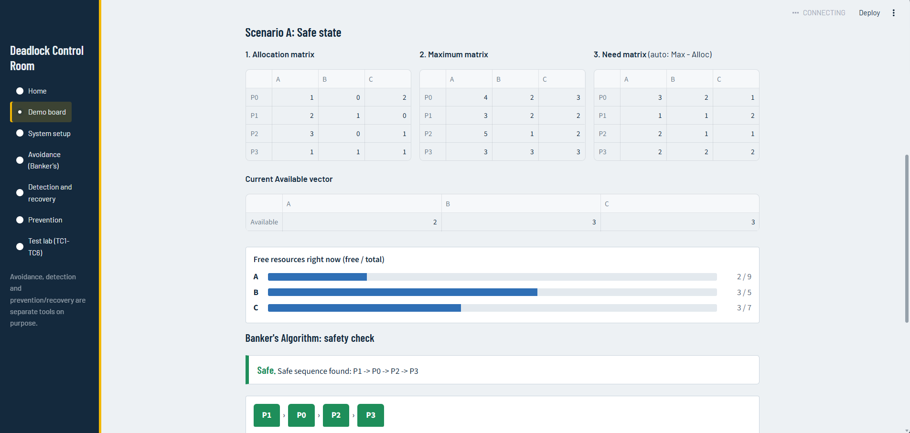
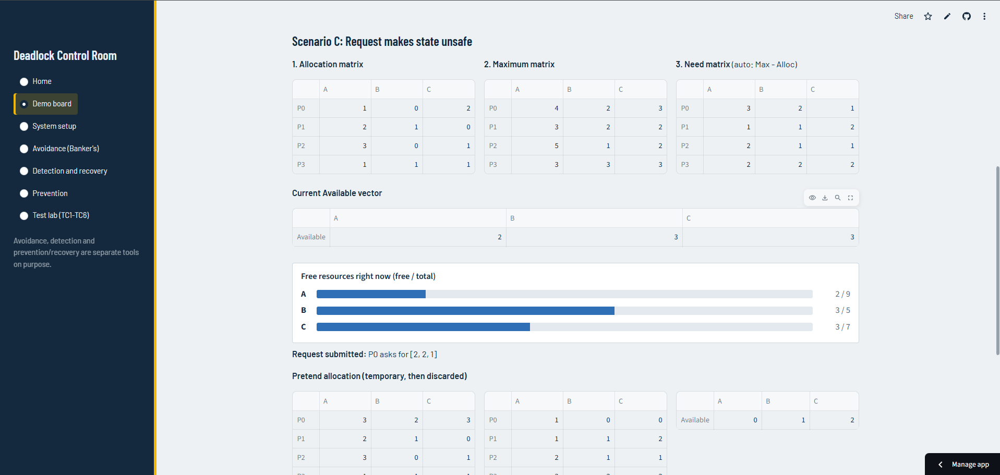
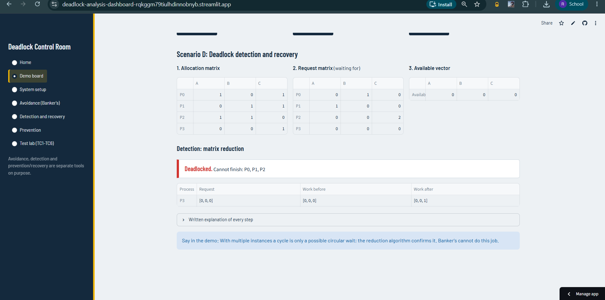
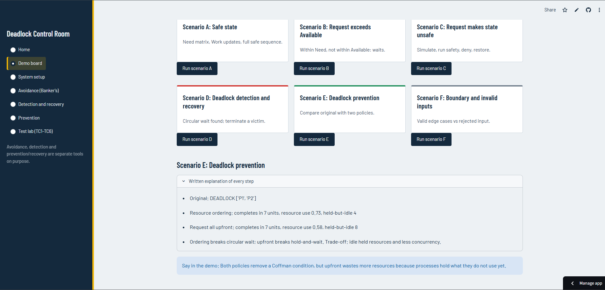

# Deadlock Control Room (OS IA Activity 2)

    <div align="center">

# 🚦 Deadlock Control Room

### Deadlock Analysis and Resource Allocation Dashboard

[](https://www.python.org/)
[](https://streamlit.io/)
[](test_logic.py)
[](#)
[](https://YOUR-APP-NAME.streamlit.app)

**An interactive signal-box style dashboard that shows how an operating system handles deadlock:**
**Prevention 🛡️ · Avoidance 🏦 · Detection 🔍 · Recovery 🔧**

*Built for Operating Systems IA, Activity 2: AI-Assisted Dashboard Development and Deadlock Analysis*

</div>

---

## ⚡ Quick Links

- 🌐 **Live Web App:** [Open the dashboard](https://YOUR-APP-NAME.streamlit.app) *(replace with your deployed link)*
- 📄 **Source Code:** [GitHub Repository](https://github.com/Ragini-telange/Deadlock-Analysis-Dashboard)
- 🧪 **Test Suite:** 14 passing tests (`python -m pytest -v`)
- 🤖 **AI Usage Record:** [AI_USAGE_RECORD.md](AI_USAGE_RECORD.md)
- 👥 **Group:** *add member names here*

---

## 🚉 The Idea

A **deadlock** is a junction where every train waits for a track another train is sitting on. This dashboard treats processes as trains and resources as track sections. A **signal gantry** at the top of every page lights one lamp for the latest result, so the system state is readable at a glance.

---

## 🚦 System Signals

The dashboard keeps five states clearly separate. They are never interchangeable.

| Signal | Lamp | Meaning |
|:--|:--:|:--|
| **SAFE** | 🟢 | A safe sequence exists, or a granted request keeps the state safe |
| **UNSAFE** | 🟠 | No safe sequence. The request that caused it is **denied** and the original state is **restored** |
| **WAITING / DEFERRED** | 🔵 | Request is within Need but exceeds Available. Legal, just not possible right now |
| **DEADLOCKED** | 🔴 | Detection found processes that can never finish |
| **INVALID INPUT** | ⚪ | Bad data: wrong id, negative number, Allocation > Maximum, Request > Need |

> ⚠️ **Unsafe ≠ Deadlocked.** Unsafe only means no completion order is guaranteed. Nobody is blocked yet. Every deadlocked state is unsafe, but an unsafe state may never deadlock.
>
> 🏦 **Banker's Algorithm is avoidance, not detection.** It checks whether granting a request keeps the system safe. It cannot find a deadlock that already exists, so detection is a separate tool.

---

## 🧭 Dashboard Pages

| | Page | What it does |
|:--:|:--|:--|
| 🏠 | **Home** | Explains the four strategies and safe vs unsafe vs deadlocked with a diagram |
| 🎬 | **Demo board** | One click runs scenario A to F, shows the matrices and traces, and gives a talking point for the demo |
| ⚙️ | **System setup** | Enter processes, resources, Allocation, Maximum and Available. **Need = Max − Alloc** is automatic |
| 🏦 | **Avoidance (Banker's)** | Safety check with Work-vector trace, a slider to step through the safe sequence, and a request form (Granted / Waiting / Denied / Invalid) |
| 🔍 | **Detection and recovery** | Multiple-instance matrix reduction and single-instance wait-for graph, with victim termination and re-check |
| 🛡️ | **Prevention** | Compares no policy, resource ordering and request-all-upfront with measured trade-offs |
| 🧪 | **Test lab (TC1–TC6)** | Builds the analytical results table from real outputs, with space for analysis and CSV export |

---

## 🚀 Getting Started

### 🌐 Option 1: Live demo (no setup)
Open the deployed link above in any browser.

### 💻 Option 2: Run locally (Python 3.10+)

```bash
# 1. Clone the repository
git clone https://github.com/Ragini-telange/Deadlock-Analysis-Dashboard.git
cd Deadlock-Analysis-Dashboard

# 2. Install dependencies
python -m pip install -r requirements.txt

# 3. Start the dashboard
python -m streamlit run app.py
```

The app opens at **http://localhost:8501**.

### 🧪 Run the tests

```bash
python -m pip install pytest
python -m pytest -v
```

---

## 🎯 Test Scenarios A–F and Actual Results

All scenarios use the group's **own datasets**.

**Main system:** 4 processes · 3 resource types (A, B, C) · totals A=9, B=5, C=7 · Available = `[2, 3, 3]`

| | Scenario | What is tested | Actual result |
|:--:|:--|:--|:--|
| ✅ | **A: Safe state** | Need = Max − Alloc, then the safety algorithm | Safe sequence **P1 ➔ P0 ➔ P2 ➔ P3**. Work: `[2,3,3]` ➔ `[4,4,3]` ➔ `[5,4,5]` ➔ `[8,4,6]` ➔ `[9,5,7]` |
| ⏳ | **B: Exceeds Available** | P0 requests `[3,0,0]`, within Need `[3,2,1]` but only 2 of A are free | **WAITING / DEFERRED.** State unchanged. Not invalid |
| 🚫 | **C: Unsafe request** | P0 requests `[2,2,1]`, within Need and Available | Pretend Available `[0,1,2]`, no process can finish. **Denied, state restored** |
| 💥 | **D: Detection & recovery** | Multiple-instance system, Available `[0,0,0]`, plus a single-instance wait-for graph | **P0, P1, P2 deadlocked** (P3 finishes). Single cycle P1 ➔ P2 ➔ P1. Terminating P0 releases `[1,0,1]` and the rest finish |
| 🛡️ | **E: Prevention** | Two processes request R1 and R2 in opposite orders | Original **deadlocks**. Ordering and upfront both finish in 7 units. Resource use 0.73 vs 0.58, so upfront wastes more |
| 🔬 | **F: Boundary & invalid** | Zero Available, zero Need, bad id, negative request, Alloc > Max, Request > Need | 3 valid boundary cases accepted, 4 invalid inputs rejected with messages |

### 📈 Live Analytical Results (TC1–TC6)

| Test Case | System Condition | Expected Result | Match |
|:--:|:--|:--|:--:|
| **TC1** | Safe state | Safe sequence found | ✅ PASS |
| **TC2** | Request exceeds Available | Request not granted immediately | ✅ PASS |
| **TC3** | Request makes state unsafe | Request denied; state unchanged | ✅ PASS |
| **TC4** | Deadlocked scenario | Deadlock identified by chosen method | ✅ PASS |
| **TC5** | Prevention policy applied | Deadlock condition eliminated | ✅ PASS |
| **TC6** | Boundary and invalid inputs | Correct handling or validation message | ✅ PASS |

---

## 🔍 Detection Model

The assignment asks us to state the resource model, so:

- 🧮 **Multiple-instance resources:** matrix reduction. A cycle in the resource-allocation graph is shown but **not** treated as proof, because another process may release an instance. A dataset with a cycle and **no** deadlock is included.
- 🕸️ **Single-instance resources:** wait-for graph. Here a cycle **is** a deadlock.

🔧 **Recovery rule:** terminate the deadlocked process holding the fewest resources (lowest number on a tie), release its resources, and run detection again.

---

## 📂 Project Structure

```
.
├── app.py                 # Streamlit pages and layout (display only)
├── ui.py                  # Theme, signal gantry, visual components
├── banker.py              # Avoidance: Need, safety check, request handling
├── detection.py           # Detection (matrix + graph) and recovery
├── prevention.py          # Prevention policies and simulator
├── validation.py          # Input checks and boundary-case notes
├── scenarios.py           # Group datasets and TC1–TC6 runner
├── test_logic.py          # 14 pytest tests
├── AI_USAGE_RECORD.md     # AI tools used and how output was verified
├── requirements.txt
└── .streamlit/config.toml # Colour theme
```

> 🧠 The algorithms live in `banker.py`, `detection.py`, `prevention.py` and `validation.py`. The screens only call them, so the logic can be tested without the interface.

---

## 🖼️ Screenshots

<details>
<summary><b>👉 Click to view dashboard screenshots</b></summary>

<br>

| Scenario A: Safe state | Scenario C: Unsafe, denied |
|:--:|:--:|
|  |  |

| Scenario D: Deadlock detected | Scenario E: Prevention |
|:--:|:--:|
|  |  |

*Add your images to a `screenshots/` folder with these names.*

</details>

---

## 🎓 Viva Quick Guide

| Function | Job |
|:--|:--|
| `banker.calculate_need(max, alloc)` | Need = Maximum − Allocation |
| `banker.safety_check(alloc, need, avail)` | Picks a process whose Need ≤ Work, adds its Allocation back to Work, repeats. Returns the safe sequence and Work trace |
| `banker.handle_request(...)` | Validity ➔ Request ≤ Need ➔ Request ≤ Available ➔ pretend allocation ➔ safety check ➔ grant or deny. Original state never modified |
| `detection.detect_multi(...)` | Matrix reduction. Processes with Request ≤ Work finish and release. Unfinished ones are deadlocked |
| `detection.detect_single(...)` | Builds the wait-for graph and finds cycles |
| `detection.choose_victim / recover_multi` | Picks the cheapest victim, terminates it, releases its resources |
| `prevention.simulate(...)` | Tick-by-tick comparison of no policy, ordering and upfront |
| `validation.validate_state(...)` | Rejects negatives, non-integers, shape errors, Alloc > Max. Reports valid boundary cases |

---

## 🤖 AI Usage Record

AI tools were used for design, algorithm and code assistance, and test generation. Nothing was trusted blindly:

- ✍️ The Need matrix, safe sequence and unsafe request were **solved by hand first**, then compared with the dashboard.
- 🧪 The pytest suite re-checks every scenario automatically.
- 🔒 No confidential institutional data or credentials were shared with any AI tool.

Full details: [AI_USAGE_RECORD.md](AI_USAGE_RECORD.md)

---

<div align="center">

**Made for Operating Systems · Activity 2** 🚦

</div>
